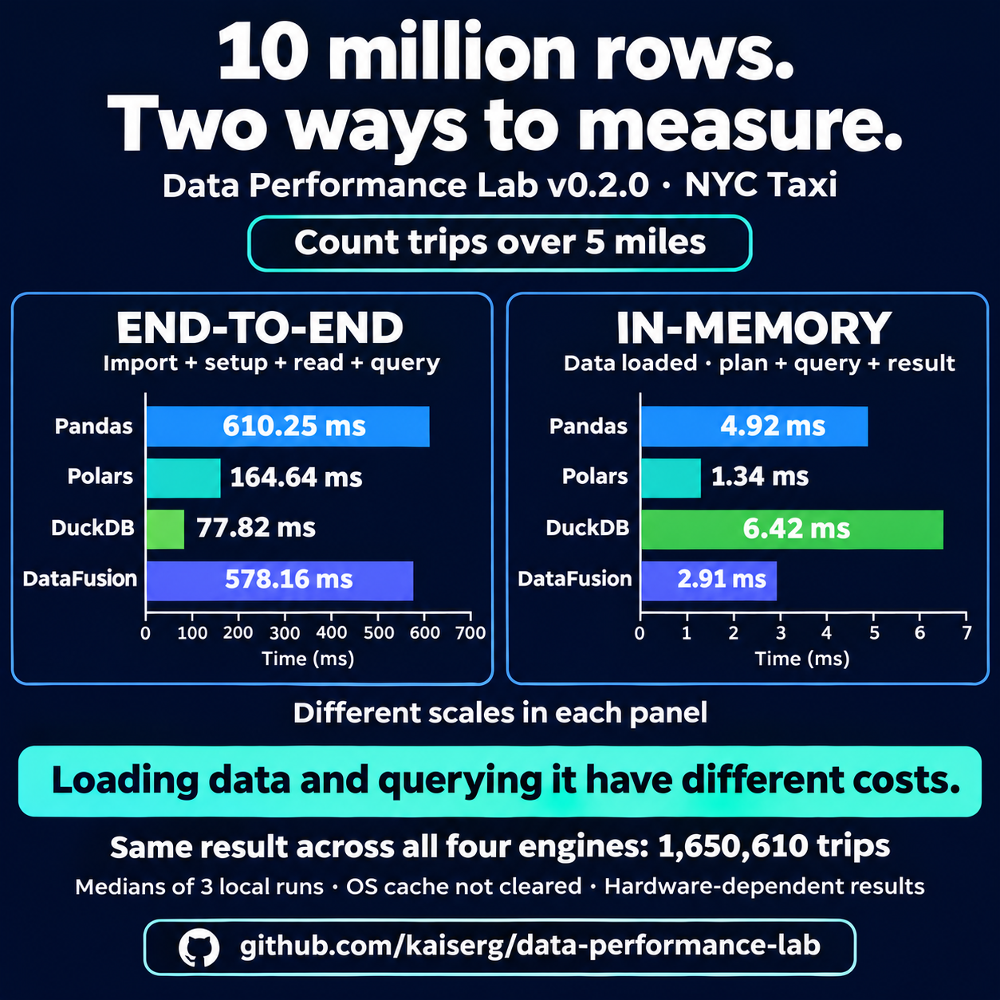

# Data Performance Lab · v0.2

A local, reproducible analytics lab comparing **Pandas, Polars, DuckDB and optional Rust/Apache DataFusion** on NYC Yellow Taxi data. Next.js charts, FastAPI, validated results, an explorer and saved benchmark history. No Docker required.

## What we learned: 10 million rows

Loading data and querying it are different costs. For **counting trips over five miles**, the same four engines returned **1,650,610 trips**, but the timing mode changed the comparison:



| Engine | End-to-end (ms) | In-memory (ms) |
| --- | ---: | ---: |
| Pandas | 610.25 | 4.92 |
| Polars | 164.64 | 1.34 |
| DuckDB | 77.82 | 6.42 |
| Apache DataFusion | 578.16 | 2.91 |

**End-to-end** includes engine import, setup, reading and query execution; it excludes Python process launch. **In-memory** excludes engine import and eager loading, while still including query planning and result materialization. The infographic uses a separate time scale for each panel.

DataFusion's end-to-end time was close to Pandas, but its in-memory query took about **41% less time**. DuckDB had the lowest end-to-end time, while Polars had the lowest in-memory time in this workload. For a one-off query, the full cost matters; for repeated queries over loaded data, setup can be amortized. These observations describe this experiment, not a universal engine ranking.

*Local medians of three measured repetitions per engine and mode, with one discarded warmup and a thread setting of four. macOS arm64, Python 3.13.15; Pandas 3.1.1, Polars 2.1.0, DuckDB 2.0.0 and DataFusion 54.1.0. Both modes used the same 10M-row Parquet file (SHA-256: `2d7f3a56a3437ade3e40b4d1292316537d8ac3b5e20245850be79ce4d02207aa`). The OS file cache was not cleared, and each engine uses its own in-memory representation. Results depend on hardware, versions, data and workload. See the [methodology](docs/methodology.md).*

To reproduce both modes with all four engines, after installing the optional Rust extra and preparing the data, run from `backend/`:

```sh
uv run python -m app.benchmark --sizes 10m --operations distance --modes end-to-end in-memory --engines pandas polars duckdb datafusion --repeats 3 --warmups 1 --threads 4
```

## Requirements and installation

macOS (Intel/Apple Silicon), Linux, or Windows PowerShell: Python 3.13+, uv, Node.js 22+ and pnpm. Install these from their official distributions; on Windows use native PowerShell or WSL consistently. Allow several GB of disk and RAM; a 10M Pandas run can consume substantial memory.

Clone this repository:

```sh
git clone https://github.com/kaiserg/data-performance-lab.git
cd data-performance-lab/backend
uv sync --locked
# Optional fourth engine: Rust DataFusion through its official Python bindings.
uv sync --locked --extra rust
# Existing local 10M data: only derive the smaller sizes.
uv run python ../scripts/prepare.py
```

If you do not have `data/taxi-10m.parquet`, run `uv run python ../scripts/download.py` first. This downloads official 2023 monthly TLC files; it requires internet. Then run `prepare.py`. Sizes are exact 100,000 / 1,000,000 / 10,000,000 rows. Smaller datasets are deterministic prefixes of the existing source, not random representative samples. Existing 10M data is preserved by preparation.

```sh
# Terminal 1, from backend/
uv run uvicorn app.main:app --reload --port 8000
# Terminal 2, from the repository root
cd frontend
pnpm install --frozen-lockfile
pnpm dev
```

Open [dashboard](http://localhost:3000) or [API docs](http://localhost:8000/docs). Choose size, timing mode, operation and repeats. Rust is enabled only when installed. Use the history selector and JSON download to inspect prior runs. The explorer filters by distance and shows daily counts and a bounded row preview. Source outliers are retained.

For a different API address copy `frontend/.env.example` to `frontend/.env.local` and edit `NEXT_PUBLIC_API_URL` before building. Defaults support localhost and 127.0.0.1:3000. This unauthenticated API is intended for local use.

## CLI and reproducibility

```sh
cd backend
# Full 3-size × 3-query × 2-mode matrix, 3 engines, one warmup + 3 measured runs
uv run python -m app.benchmark
# Include Rust; customize the matrix
uv run python -m app.benchmark --engines pandas polars duckdb datafusion --repeats 3 --threads 4
# Smaller smoke run
uv run python -m app.benchmark --sizes 100k --operations distance --modes end-to-end in-memory --repeats 1
# v0.1 command remains supported; JSON retains result, seconds, peak_rss_mb
uv run python -m app.worker duckdb daily ../data/taxi-10m.parquet
```

Runs are saved atomically in ignored `results/<uuid>.json`. Each contains raw samples, median/min/max times, memory, warmups, seeded engine order, dataset SHA-256, row count, versions, OS, architecture, CPU count and thread settings. HTTP defaults remain 10M / average / 3 repetitions / the original three engines. History returns the latest 100 records. A failed validation prevents saving a successful run. Full methodology: [docs/methodology.md](docs/methodology.md).

## Tests and production build

[](https://github.com/kaiserg/data-performance-lab/actions/workflows/ci.yml)

GitHub Actions runs backend tests (Python 3.13, all four engines including DataFusion) and the Next.js production build (Node 24, pnpm 12.6.0) in parallel on every push and pull request. Dependencies use the committed lockfiles. Tests generate tiny synthetic Parquet fixtures in temporary directories; CI never runs the dataset downloader, preparation scripts or benchmark matrix and verifies that no `data/` or `results/` directory is created.

```sh
cd backend
uv run pytest -q
# From repository root in a separate terminal
cd frontend
pnpm build
pnpm start
```

Tests exercise every installed engine in both modes with nulls, boundary distances, multiple dates and negative fares; they also cover API validation and history persistence. DataFusion tests skip if the optional extra is absent.

## Observed v0.1 result

User-observed local 10M distance >5 benchmark (historical, not a v0.2 rerun):

| Engine | Seconds | Peak RSS MB | Matching trips |
| --- | ---: | ---: | ---: |
| Pandas | 0.5905 | 685.27 | 1,650,610 |
| Polars | 0.1605 | 153.95 | 1,650,610 |
| DuckDB | 0.0765 | 78.91 | 1,650,610 |

These figures are machine/cache/version dependent and are not a universal ranking. v0.2 daily validation and timing details differ; compare only matching protocols.

## Project and contributions

`backend/app/worker.py`: isolated samples; `benchmark.py`: matrix, validation and history; `main.py`: API; `frontend/app`: dashboard; `scripts`: local datasets; `docs`: methodology. No datasets or generated history belong in Git. See [CONTRIBUTING.md](CONTRIBUTING.md).

Code is [MIT licensed](LICENSE). Taxi data is supplied separately by [NYC TLC](https://www.nyc.gov/site/tlc/about/tlc-trip-record-data.page); the code license does not relicense it. DataFusion uses its [official Python API](https://datafusion.apache.org/python/); no Rust toolchain is required when a compatible wheel is available. This is the Rust query engine via Python bindings, not a standalone Rust CLI.
